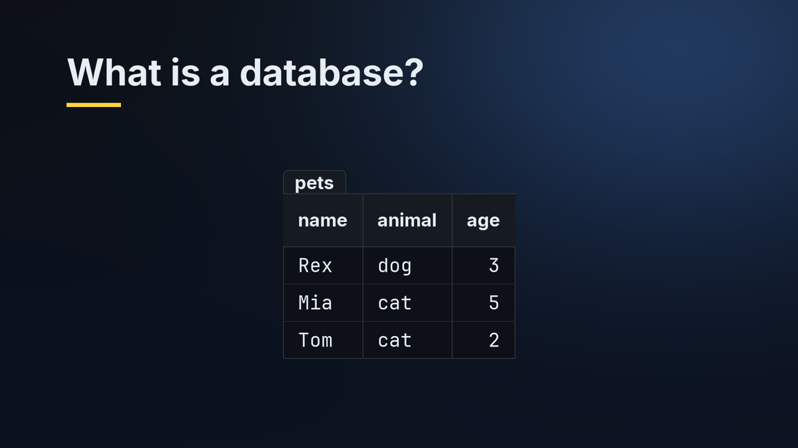
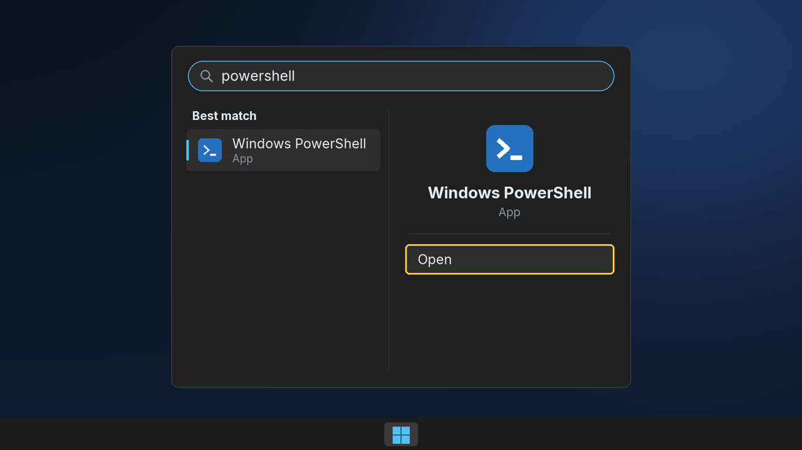
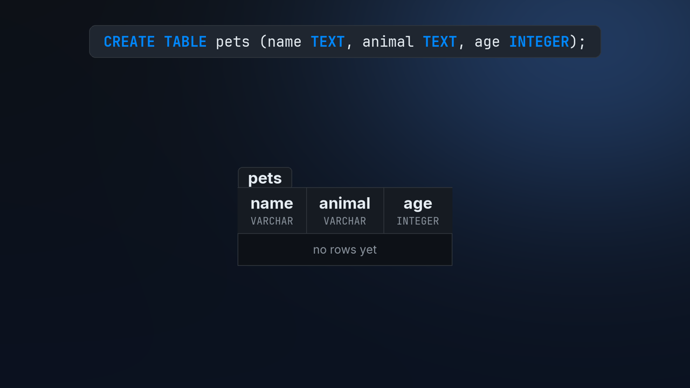
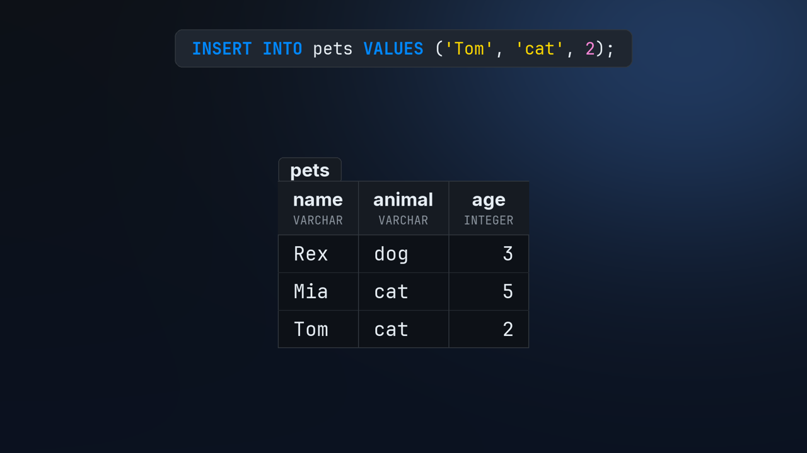
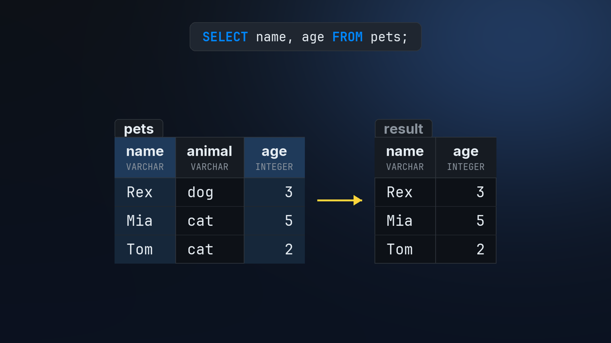

# Episode 1: Install DuckDB and Run Your First SQL Query

The written guide to episode 1 of SQL from Zero. Keep it open next to the video, or follow it on its own. Every command here is exactly what the video types, and every output is real.

**Tested with:** Windows 11, Windows PowerShell 5.1, winget and DuckDB 1.5.6 (October 2026). Newer versions may print slightly different text.

## Contents

1. [Intro](#intro) (0:00 in the video)
2. [What is a database?](#what-is-a-database) (0:31 in the video)
3. [What is SQL?](#what-is-sql) (1:16 in the video)
4. [Why DuckDB?](#why-duckdb) (1:48 in the video)
5. [The plan](#the-plan) (2:17 in the video)
6. [Open PowerShell](#open-powershell) (2:41 in the video)
7. [Meet PowerShell](#meet-powershell) (3:20 in the video)
8. [Install DuckDB](#install-duckdb) (5:01 in the video)
9. [Your first query](#your-first-query) (6:49 in the video)
10. [When something goes wrong](#when-something-goes-wrong) (8:29 in the video)
11. [Make your first table](#make-your-first-table) (9:54 in the video)
12. [Recap](#recap) (13:05 in the video)
13. [Next week](#next-week) (13:52 in the video)

## Intro

Welcome to the very first episode of SQL from Zero. By the end of this video, you'll have a database on your computer. And you'll have asked it your first questions in SQL.

You don't need any experience. You don't even need to have opened PowerShell before. I'll go step by step. Pause the video whenever you need to, and type along with me.

## What is a database?



So, what is a database? A database is a place to keep data, organized so you can find things fast.

Inside a database, data lives in tables. A table looks a bit like a spreadsheet. Here's a small one, about pets. You'll build this exact table yourself, later in this video.

Each column holds one kind of fact. This column holds what kind of animal each pet is.

And each row is one thing. Here, each row is one pet. This one is Mia, a cat who is five.

Unlike a spreadsheet, a database is built to hold huge amounts of data, and to answer questions about it quickly.

Almost every app and website you use keeps its data in a database.

## What is SQL?

- **SQL**: the language for asking a database questions
- `SELECT name FROM pets WHERE age > 2;`
- Say it "S-Q-L" or "sequel": both are fine
- Learn it once, use it with almost every database

To ask a database a question, you use a language called SQL.

## Why DuckDB?

- Free, and just one small program
- No server, no password, nothing to set up
- Your whole database is saved in one file
- Its SQL closely follows PostgreSQL, which many companies use

In this course, we'll use a database called DuckDB.

## The plan

- Meet PowerShell: where you type commands
- Install DuckDB with one command
- Ask your first questions in SQL
- Make a table, and save it in a file

I'm on Windows. On a Mac or Linux, only the install command is different, and it's in the description.

## Open PowerShell



If you already know how to open PowerShell, skip to [Install DuckDB](#install-duckdb).

Let's open PowerShell. It takes three quick steps.

First, press the Windows key on your keyboard. It's the one with the Windows logo, near the bottom left. The Start menu opens.

Now just type PowerShell. You don't need to click anywhere first. The search starts as soon as you type.

```
powershell
```

Under Best match, you'll see Windows PowerShell. Press Enter, or click Open.

On Windows 10, the Start menu looks a little different, but the same three steps work.

## Meet PowerShell

Open PowerShell now. On Windows 11, it may open inside an app called Terminal. That's the same thing.

PowerShell is a place where you type commands to your computer, instead of clicking on things. It looks plain, but every programmer uses something like it.

This line is called the prompt. PS stands for PowerShell. After it is the folder you're in right now, which is your user folder. Yours will show your own name. And the blinking box means PowerShell is waiting for you to type.

> **The prompt**  
> PS            = PowerShell  
> C:\Users\you  = the folder you're in  

Let's try a command. Type echo, a space, then Hello in quotes, and press Enter.

```powershell
echo "Hello!"
```

You'll see:

```
Hello!
```

PowerShell answers with Hello. That's all a command is. You type a line, press Enter, and the computer answers.

Now let's make a typo on purpose. I'll swap two letters in echo.

```powershell
ehco "Hello!"
```

You'll see:

```
ehco : The term 'ehco' is not recognized as the name of a cmdlet, function, script
file, or operable program. Check the spelling of the name, or if a path was
included, verify that the path is correct and try again.
At line:1 char:1
+ ehco "Hello!"
+ ~~~~
    + CategoryInfo          : ObjectNotFound: (ehco:String) [], CommandNotFoundExcep
   tion
    + FullyQualifiedErrorId : CommandNotFoundException
```

PowerShell answers in red: the term is not recognized. That means it doesn't know that word. Red text looks scary, but it just means something went wrong, and the first line usually says what.

To fix it, type the command again, spelled correctly. Here's a handy trick: the up arrow key brings back your last command, so you only need to fix the typo.

```powershell
echo "Hello!"
```

You'll see:

```
Hello!
```

You can also paste commands instead of typing them. Copy a command from this guide, click in PowerShell, and press Ctrl+V, or just right-click.

> **Paste a command**  
> Ctrl+V  or  right-click  

And don't worry. You can't break your computer with the commands in this video. Let's install DuckDB.

## Install DuckDB

To install DuckDB, we'll use winget. winget is the app installer that comes with Windows 11, and with up-to-date Windows 10.

Type this, and press Enter. CLI means the command line version:

```powershell
winget install DuckDB.cli
```

You'll see:

```
Found DuckDB CLI [DuckDB.cli] Version 1.5.6
This application is licensed to you by its owner.
Microsoft is not responsible for, nor does it grant any licenses to, third-party packages.
Downloading https://github.com/duckdb/duckdb/releases/download/v1.5.6/duckdb_cli-windows-amd64.zip
  ██████████████████████████████  12.3 MB / 12.3 MB
Successfully verified installer hash
Extracting archive...
Successfully extracted archive
Starting package install...
Path environment variable modified; restart your shell to use the new value.
Command line alias added: "duckdb"
Successfully installed
```

The first time you use winget, it may ask you to agree to the terms of its app sources. If it does, type Y, and press Enter.

> **Asked to agree to terms?**  
> Type Y, then press Enter.  

Then winget finds DuckDB, and downloads it from DuckDB's official page on GitHub. A bar shows the download. It usually takes less than a minute.

When you see Successfully installed, it's done. Look at the yellow line above it. It says: restart your shell. Shell is just another word for this window.

On a Mac or Linux, open the Terminal app and run `curl https://install.duckdb.org | bash`, then follow the "Hint" line it prints to add DuckDB to your PATH. On a Mac with Homebrew, `brew install duckdb` also works.

> **On a Mac or Linux?**  
> The install command is  
> in the description.  

So close PowerShell, and open a new one, the same way as before. This step matters. A PowerShell window only knows about programs that were installed before it was opened.

Now type this, and press Enter:

```powershell
duckdb --version
```

You'll see:

```
v1.5.6 (Variegata) 069cc9f9b5
```

If you see a version number, DuckDB is installed. Yours might be a little newer than mine, and that's fine.

But what if you get a red message instead?

```powershell
duckdb --version
```

You'll see:

```
duckdb : The term 'duckdb' is not recognized as the name of a cmdlet, function,
script file, or operable program. Check the spelling of the name, or if a path was
included, verify that the path is correct and try again.
At line:1 char:1
+ duckdb --version
+ ~~~~~~
    + CategoryInfo          : ObjectNotFound: (duckdb:String) [], CommandNotFoundExc
   eption
    + FullyQualifiedErrorId : CommandNotFoundException
```

It says the term duckdb is not recognized. Don't worry, this is the most common problem. It almost always means this window was already open when DuckDB was installed. Close every PowerShell window, open a new one, and try again.

> **duckdb not recognized?**  
> Close every PowerShell window,  
> open a new one, try again.  

## Your first query

Now let's start DuckDB. Type duckdb, and press Enter.

```powershell
duckdb
```

You'll see:

```
DuckDB v1.5.6 (Variegata)
Enter ".help" for usage hints.
```

DuckDB starts, and shows its version. Under that is a tip about dot help, which we won't need today.

See how the prompt changed? This is DuckDB's prompt now, not PowerShell's. memory is the database we're in. It only lives in your computer's memory, so it's gone when you leave DuckDB. That's perfect for trying things out. And D means DuckDB is ready for you to type.

> **DuckDB's prompt**  
> memory = the database you're in  
> D      = DuckDB is ready  

Today is just a first taste of SQL. You don't need to memorize anything. Every part we use today gets its own episode later, where we go slowly.

Let's ask our first question. Type this, and press Enter:

```sql
SELECT 2 + 3;
```

You'll see:

```
┌─────────┐
│ (2 + 3) │
│  int32  │
├─────────┤
│       5 │
└─────────┘
```

DuckDB answers with a small table. SELECT means show me. On top is the column's name. DuckDB just used what we typed.

Under the name is the column's type. int32 means a whole number. And below the line is the answer, 5.

Every answer in SQL comes back as a table, even when it's just one value.

The semicolon at the end tells DuckDB that your command is finished.

> **The semicolon ;**  
> ends every SQL command  

Now let's try text. Text in SQL goes in single quotes:

```sql
SELECT 'Hello, SQL!' AS greeting;
```

You'll see:

```
┌─────────────┐
│  greeting   │
│   varchar   │
├─────────────┤
│ Hello, SQL! │
└─────────────┘
```

AS gives the column a name, greeting. And its type is varchar, which is SQL's word for text.

## When something goes wrong

Now let's make some mistakes on purpose, so you'll know what to do when they happen.

Leave out the T in SELECT:

```sql
SELEC 42;
```

You'll see:

```
Parser Error:
syntax error at or near "SELEC"

LINE 1: SELEC 42;
        ^
```

DuckDB answers in red: Parser Error, syntax error at or near SELEC. That means it didn't understand that word. The little arrow points to where it got confused.

To fix it, type the line again, correctly. Or press the up arrow key. It brings back the line you typed, so you only need to fix the typo.

```sql
SELECT 42;
```

You'll see:

```
┌───────┐
│  42   │
│ int32 │
├───────┤
│    42 │
└───────┘
```

Fixed. Now DuckDB understands it.

Now the most common mistake of all. Type this, without the semicolon, and press Enter:

```sql
SELECT 2 + 3
```

Nothing happens. DuckDB just moves to a new line, and waits. Without a semicolon, it thinks you haven't finished your command yet.

No problem. Type a semicolon, and press Enter:

```sql
;
```

You'll see:

```
┌─────────┐
│ (2 + 3) │
│  int32  │
├─────────┤
│       5 │
└─────────┘
```

> **Nothing happened?**  
> Type ; and press Enter.  

To leave DuckDB, type this, and press Enter. Commands that start with a dot are DuckDB's own commands, not SQL. That's why they don't need a semicolon:

```sql
.exit
```

We're back in PowerShell. And because that database lived in memory, everything in it is gone. So let's make one that's saved in a file.

## Make your first table

Type this. shop.duckdb is the name of a file. If the file doesn't exist yet, DuckDB creates it:

```powershell
duckdb shop.duckdb
```

You'll see:

```
DuckDB v1.5.6 (Variegata)
Enter ".help" for usage hints.
```

The prompt now says shop. That's our database, and it's saved in a file in your user folder.

Next, we'll make a table and put some rows in it, with two new commands: CREATE TABLE and INSERT. Don't worry about remembering how they work today. Later episodes cover both properly, step by step. For now, just type along and watch what happens.

> **New today: CREATE TABLE, INSERT**  
> Just type along for now.  
> Later episodes cover them properly.  

Let's make a table for pets. After CREATE TABLE pets come the columns, in parentheses, with a comma between them: name, which is TEXT, animal, also TEXT, and age, which is an INTEGER (a whole number). Type it exactly like this:

```sql
CREATE TABLE pets (name TEXT, animal TEXT, age INTEGER);
```

DuckDB doesn't print anything. No message means it worked.



Here's what just happened inside the database. CREATE TABLE made a new table called pets, with three columns: name, animal, and age.

Under each name is the column's type. We typed TEXT, which DuckDB calls VARCHAR. Both mean text. And INTEGER means a whole number.

The table has no rows yet. It's like a spreadsheet with only the headings filled in.

Now let's add some rows: one pair of parentheses for each row, with a comma between them. The values go in the same order as the columns: name, animal, age.

```sql
INSERT INTO pets VALUES ('Rex', 'dog', 3), ('Mia', 'cat', 5);
```

You can add more rows any time. Here's one more.

```sql
INSERT INTO pets VALUES ('Tom', 'cat', 2);
```



And here's what INSERT did. The first one added two rows, one for each pair of parentheses. Each value went into its own column, in order.

The second INSERT added one more row. Now the table holds three pets.

Now let's see the whole table. The star means every column:

```sql
SELECT * FROM pets;
```

You'll see:

```
┌─────────┬─────────┬───────┐
│  name   │ animal  │  age  │
│ varchar │ varchar │ int32 │
├─────────┼─────────┼───────┤
│ Rex     │ dog     │     3 │
│ Mia     │ cat     │     5 │
│ Tom     │ cat     │     2 │
└─────────┴─────────┴───────┘
```

There it is. Three columns: name, animal, and age. And three rows, one for each pet.

In results, DuckDB writes the types in short: varchar for text, and int32 for whole numbers.

If you only want some of the columns, name them, with a comma in between.

```sql
SELECT name, age FROM pets;
```

You'll see:

```
┌─────────┬───────┐
│  name   │  age  │
│ varchar │ int32 │
├─────────┼───────┤
│ Rex     │     3 │
│ Mia     │     5 │
│ Tom     │     2 │
└─────────┴───────┘
```



Here's what that SELECT did. It read the name and age columns, and gave us back a new table with just those two.

The pets table itself didn't change. A SELECT like this only reads your data. It doesn't change it.

Now leave DuckDB:

```sql
.exit
```

Here's the best part. Open the same file again.

```powershell
duckdb shop.duckdb
```

You'll see:

```
DuckDB v1.5.6 (Variegata)
Enter ".help" for usage hints.
```

And ask for every pet.

```sql
SELECT * FROM pets;
```

You'll see:

```
┌─────────┬─────────┬───────┐
│  name   │ animal  │  age  │
│ varchar │ varchar │ int32 │
├─────────┼─────────┼───────┤
│ Rex     │ dog     │     3 │
│ Mia     │ cat     │     5 │
│ Tom     │ cat     │     2 │
└─────────┴─────────┴───────┘
```

Our pets are still there. They were saved in the file, so they'll still be there tomorrow.

Leave DuckDB, and you're done:

```sql
.exit
```

## Recap

- `winget install DuckDB.cli` installs DuckDB
- `duckdb shop.duckdb` opens a database file, or creates it
- `CREATE TABLE` makes a table, `INSERT INTO` adds rows
- `SELECT ... FROM` asks a question, and `;` ends it
- `.exit` leaves DuckDB

If CREATE TABLE and INSERT still feel new, that's completely normal. We'll come back to each of them, slowly, in the coming episodes.

Before next week, try this. Open shop.duckdb again. Copy one of the INSERT lines above, and change it to add a pet of your own. Then select all the pets again.

## Next week

That's it for episode one. You installed DuckDB, asked your first questions in SQL, and made your first table, saved in a file.

Next week, we'll get much better at SELECT. We'll choose columns, give them names, and do math with them. If this helped, subscribe so you don't miss it. See you next week.
